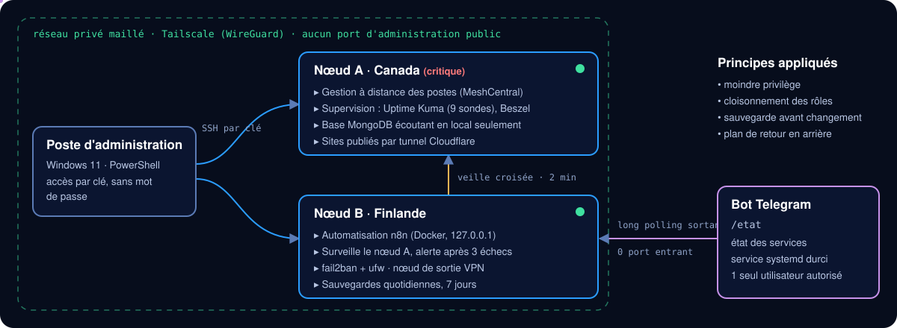
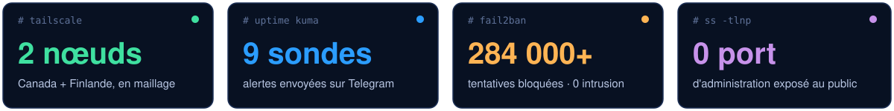

  

  

Réseaux, téléphonie IP, supervision et homelab. J'aime comprendre comment un paquet passe d'un point A à un point B, et surtout ce qui se passe quand il n'y arrive pas.

Tout ce que je monte finit en procédure écrite, pour que n'importe qui puisse le refaire.

---

## Le lab

  

  

**Ce que le lab m'a appris (parfois à la dure) :**

- **Docker contourne le pare-feu.** Une règle `ufw` ne protège pas un port publié par Docker : chaque service écoute donc sur `127.0.0.1`, et rien d'autre.
- **Un serveur en panne ne peut pas annoncer sa propre panne.** D'où la veille croisée : le nœud de Finlande vérifie celui du Canada toutes les 2 minutes.
- **Le port le plus sûr est celui qu'on n'ouvre pas.** Le bot `/etat` fonctionne en connexion sortante seulement : aucun port entrant.
- **On prévoit le retour en arrière avant d'appliquer le changement.** Sauvegarde d'abord, toujours.

---

## Sur l'établi

<table>
<tr>
<td width="50%" valign="top">

### Un réseau qui se répare tout seul
Deux bâtiments, un lien principal, un routeur de secours. Si le lien tombe, le trafic bascule **automatiquement** grâce à des routes statiques flottantes (distance administrative 1 contre 5), sans aucun protocole de routage dynamique.

`Cisco IOS` `VLAN 802.1Q` `inter-VLAN` 
→ [**La doc**](https://github.com/Bazeeza/Projets-Runbooks/tree/main/420-H66-RO%20PROJETS-R%C3%89SEAUTIQUE-2/Route-ST)

</td>
<td width="50%" valign="top">

### Durcir un poste en une commande
Deux scripts qui lisent le CIS Benchmark en XML, **vérifient** la config d'un poste, puis la **corrigent** : Ubuntu 24.04 en Bash, Windows 11 en PowerShell. Un mode lecture seule sort un rapport sans rien toucher.

`Bash` `PowerShell` `CIS` `XML` 
→ [**Les scripts**](https://github.com/Bazeeza/Projets-Runbooks/tree/main/420-H34-RO%20UTILITAIRES-R%C3%89SEAUX-AVANC%C3%89S/TP2_CIS)

</td>
</tr>
<tr>
<td width="50%" valign="top">

### Superviser du vrai matériel
Un réseau Cisco physique (VLAN, relais DHCP, NAT) surveillé par **SNMP** et **Zabbix** : serveur AlmaLinux, agents Linux et Windows, seuils *warning* et *critical* choisis et justifiés.

`Zabbix` `SNMP v2c` `AlmaLinux` 
→ [**Les procédures**](https://github.com/Bazeeza/Projets-Runbooks/tree/main/420-H63-RO%20SUPERVISION-R%C3%89SEAUX-LOCAUX)

</td>
<td width="50%" valign="top">

### Une infra AWS écrite en code
VPC, instances EC2 et conteneurs décrits avec **Terraform** pour héberger Vaultwarden et Mattermost. En équipe : GLPI, Nextcloud et RDS MySQL, surveillés avec CloudWatch.

`Terraform` `AWS` `Docker` 
→ [**AutomationHub**](https://github.com/Bazeeza/AutomationHub) · [**Services Internet**](https://github.com/Bazeeza/Projets-Runbooks/tree/main/420-H66-RO%20PROJET-SRV-INTERNET-3)

</td>
</tr>
</table>

---

## Mes carnets

<table>
<tr>
<td width="50%" valign="top">

**[Projets-Runbooks](https://github.com/Bazeeza/Projets-Runbooks)** (FR) 
Mes projets de réseautique, pas à pas : Cisco, Zabbix, AWS, GLPI, CIS, MeshCentral.

</td>
<td width="50%" valign="top">

**[Technical-Runbooks](https://github.com/Bazeeza/Technical-Runbooks)** (EN) 
Short IT runbooks: boot & UEFI, Windows 11, software, networking, Active Directory.

</td>
</tr>
</table>

---

## Boîte à outils

  

  <code>Cisco IOS</code> <code>VLAN · OSPF · NAT · ACL</code> <code>FreePBX · SIP</code> <code>Wireshark</code> <code>WireGuard · Tailscale</code> 
  <code>Zabbix</code> <code>SNMP</code> <code>Uptime Kuma</code> <code>fail2ban · ufw</code> <code>Proxmox</code> <code>n8n</code> <code>systemd</code>

---

  Une question sur un projet, une idée de lab, ou juste envie de parler réseau ? 
  <a href="mailto:info@bazeeza.ca"><b>info@bazeeza.ca</b></a>

  

