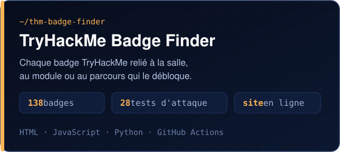
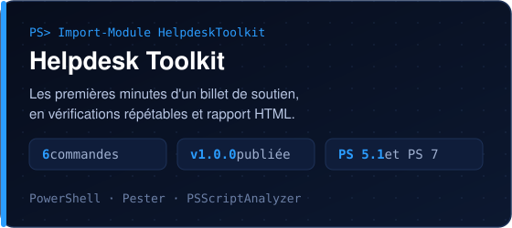
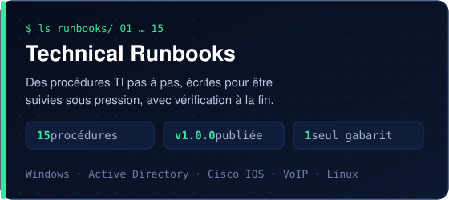
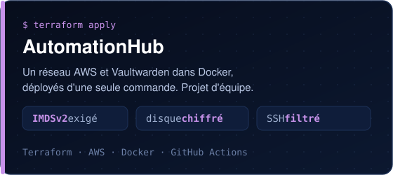

  

  

---

## Projets

<table>
<tr>
<td width="50%" valign="top">

Sur TryHackMe, on ne peut pas cliquer sur un badge pour savoir quelle salle le donne. Ce site fait le lien : **les 138 badges**, chacun avec la salle, le module ou le parcours qui le débloque.

→ [**Le site**](https://bazeeza.github.io/thm-badge-finder/) · [**Le code**](https://github.com/Bazeeza/thm-badge-finder)

</td>
<td width="50%" valign="top">

Un module PowerShell qui transforme les premières minutes d'un billet de soutien en vérifications répétables : rapport système, réseau, logiciels installés, santé du disque, rapport HTML pour le billet. **Lecture seule**, sauf le nettoyage des fichiers temporaires, qui montre d'abord ce qu'il ferait (`-WhatIf`) et demande confirmation. Testé avec Pester.

→ [**Le code**](https://github.com/Bazeeza/helpdesk-toolkit)

</td>
</tr>
<tr>
<td width="50%" valign="top">

**15 procédures TI** pas à pas, écrites pour être suivies sous pression : démarrage et UEFI, Windows 11, Active Directory, dépannage réseau, câblage et sertissage, Wi-Fi, téléphonie IP (SIP), configuration de base d'un commutateur Cisco, durcissement Linux, sauvegarde et restauration, hameçonnage, Microsoft 365. En anglais, sur un gabarit unique.

→ [**Les procédures**](https://github.com/Bazeeza/Technical-Runbooks)

</td>
<td width="50%" valign="top">

Un seul `terraform apply` construit un petit réseau AWS (VPC, sous-réseau, groupe de sécurité) et déploie le gestionnaire de mots de passe Vaultwarden dans Docker sur une instance EC2 durcie. Projet d'équipe.

→ [**Le code**](https://github.com/Bazeeza/AutomationHub)

</td>
</tr>
</table>

---

## Boîte à outils

  

  <code>Cisco IOS</code> <code>VLAN · OSPF · NAT · ACL</code> <code>FreePBX · SIP</code> <code>Wireshark</code> 
  <code>Zabbix</code> <code>SNMP</code> <code>Proxmox</code> <code>CIS Benchmark</code>

---

  Une question sur un projet, ou juste envie de parler réseau ? 
  <a href="mailto:info@bazeeza.ca"><b>info@bazeeza.ca</b></a>

  

