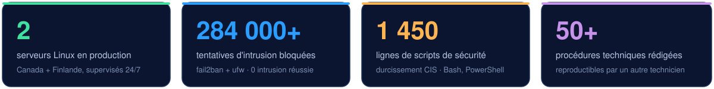
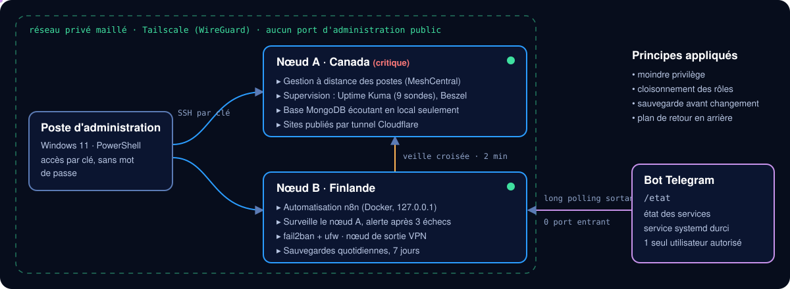

  

  
  
  

  <b>Finissant du DEC en Techniques de l'informatique, profil réseautique</b> (Collège de Rosemont). 
  En parallèle, <b>40 h/semaine en centre de données</b> (opérations 24/7) depuis 2023. 
  Je monte des réseaux, je les supervise, et je documente tout pour qu'un autre technicien puisse le refaire.

  

---

## Projets phares

### 1 · Infrastructure personnelle en production, sur deux continents

Deux serveurs Linux (Canada et Finlande) que j'administre seul, reliés par un **réseau privé maillé** : aucun port d'administration exposé sur Internet. Chaque serveur a un rôle distinct, et le second **surveille le premier** toutes les 2 minutes pour m'alerter en cas de panne.

  

- **Sécurité** : SSH par clé seulement, pare-feu `ufw` et `fail2ban` (plus de 284 000 tentatives bloquées, aucune intrusion), services Docker limités à `127.0.0.1` parce que Docker contourne le pare-feu.
- **Supervision** : Uptime Kuma (9 sondes) et Beszel pour les métriques, alertes sur Telegram.
- **Bot de supervision** : la commande `/etat` sur Telegram donne l'état des services. Le relais est un service `systemd` durci (système en lecture seule, utilisateur dynamique, 64 Mo max). Il **n'ouvre aucun port** (connexion sortante uniquement) et ne lit les données qu'en lecture seule.
- **Méthode** : sauvegarde avant chaque modification, commande de retour en arrière prévue avant d'appliquer un changement.

`Linux` `Tailscale / WireGuard` `Docker` `systemd` `Python` `n8n` `ufw` `fail2ban` `Cloudflare Tunnel`

### 2 · Réseau Cisco redondant entre deux bâtiments

Si le lien principal tombe, le trafic bascule **automatiquement** par un routeur de secours, sans protocole de routage dynamique : des **routes statiques flottantes** (distance administrative 1 contre 5). Inclut le routage inter-VLAN, le router-on-a-stick et un VLAN « trou noir » pour les ports inutilisés.

`Cisco IOS` `VLAN 802.1Q` `Routage statique` `Distance administrative` `Commutateur L3` · [**Voir la documentation**](https://github.com/Bazeeza/Projets-Runbooks/tree/main/420-H66-RO%20PROJETS-R%C3%89SEAUTIQUE-2/Route-ST)

### 3 · Durcissement automatisé selon le CIS Benchmark

Deux scripts qui **vérifient puis corrigent** la configuration de sécurité d'un poste à partir d'un fichier XML : Ubuntu 24.04 en Bash (560 lignes) et Windows 11 en PowerShell (519 lignes). Un mode validation produit un rapport sans rien modifier, et un mode correction applique les valeurs recommandées (paquets, `sysctl`, services, comptes, journalisation).

`Bash` `PowerShell` `CIS Benchmark` `XML` · [**Voir les scripts**](https://github.com/Bazeeza/Projets-Runbooks/tree/main/420-H34-RO%20UTILITAIRES-R%C3%89SEAUX-AVANC%C3%89S/TP2_CIS)

### 4 · Supervision d'un réseau sur équipements physiques

Réseau Cisco physique (VLAN, DHCP avec relais, NAT) supervisé par **SNMP** et **Zabbix** : serveur sous AlmaLinux, agents Linux et Windows, déclencheurs avec des seuils *warning* et *critical* justifiés.

`Zabbix` `SNMP v2c` `AlmaLinux` `Cisco` · [**Voir les procédures**](https://github.com/Bazeeza/Projets-Runbooks/tree/main/420-H63-RO%20SUPERVISION-R%C3%89SEAUX-LOCAUX)

### 5 · Services déployés sur AWS avec Terraform

Infrastructure décrite en code : VPC, instances EC2 et conteneurs Docker pour le gestionnaire de mots de passe Vaultwarden et la messagerie Mattermost. En équipe, j'ai aussi déployé GLPI, Nextcloud et RDS MySQL, supervisés avec CloudWatch.

`Terraform` `AWS EC2 / VPC / RDS` `CloudWatch` `Docker` · [**AutomationHub**](https://github.com/Bazeeza/AutomationHub) · [**Services Internet**](https://github.com/Bazeeza/Projets-Runbooks/tree/main/420-H66-RO%20POJET-SRV-INTERNET-3)

---

## Compétences

**Réseau et télécom**

  
  
  
  
  

**Supervision et sécurité**

  
  
  
  
  

**Systèmes, cloud et automatisation**

  
  
  
  
  
  
  

---

## Parcours

| Période | |
|---|---|
| **2023 – aujourd'hui** | **Centre de données**, opérations 24/7 : environnement critique, procédures strictes, santé et sécurité |
| **En cours (dernière année)** | **DEC en Techniques de l'informatique, profil réseautique**, Collège de Rosemont : Cisco, supervision, services Internet, sécurité, virtualisation |

---

  <b>Je cherche un poste de technicien en télécommunication ou en réseau dans la région de Montréal.</b> 
  CV sur demande : <a href="mailto:Azeez@bazeeza.ca?subject=Demande%20de%20CV">Azeez@bazeeza.ca</a>

